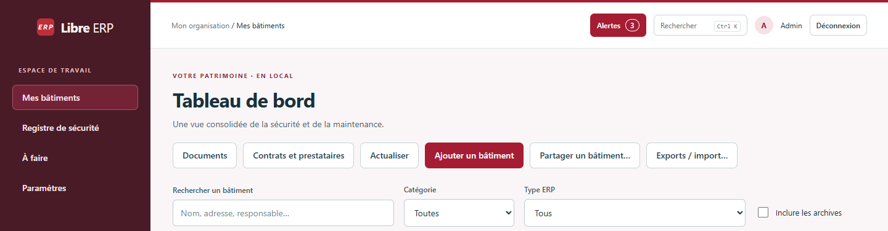

# Libre ERP - Mode d’emploi

Version 0.11.1 · 31 octobre 2026

[Télécharger la dernière version Windows](https://github.com/LaurentN1305/libre-erp/releases/latest)

Ce guide concerne la version installée. Les exemples d’écran sont fictifs.

## 1. Commencer en quelques minutes

Le parcours conseillé pour une première utilisation

Libre ERP vous aide à suivre les bâtiments recevant du public, leurs interventions, leurs équipements et leur registre de sécurité. Les données sont conservées localement.

1. Installer Libre ERP et créer votre compte exploitant.
2. Ajouter un premier bâtiment, ses types ERP et sa date d’ouverture.
3. Ouvrir sa fiche pour ajouter une intervention ou compléter son registre.
4. Créer une première sauvegarde et la conserver sur un autre support.

> **Pour travailler au quotidien**
> Ouvrez « Mes bâtiments ». Choisissez un bâtiment : sa fiche donne accès à ses interventions, son registre, son inventaire, ses contrats et ses documents.

### Retrouver une opération

- Installer et se connecter : chapitre 2.
- Créer un bâtiment et se repérer : chapitre 3.
- Suivre une intervention : chapitre 4.
- Compléter le registre de sécurité : chapitre 5.
- Gérer les équipements et les relevés : chapitre 6.
- Contrats, prestataires et documents : chapitre 7.
- Alertes, exports et import CSV : chapitre 8.
- Sauvegarder et restaurer : chapitre 9.
- Partager et régler les accès : chapitre 10.
- Mettre à jour et résoudre les problèmes courants : chapitre 11.

Guide de la version Windows installée 0.11.1 · 31 octobre 2026. Les boutons visibles dépendent de votre rôle et des fonctionnalités activées.

## 2. Installer et se connecter

À faire une seule fois sur chaque poste

### 1. Télécharger le bon fichier

1. Ouvrez la page GitHub des versions de Libre ERP : github.com/LaurentN1305/libre-erp/releases/latest.
2. Dans les fichiers de la version, choisissez le fichier se terminant par « _x64-setup.exe ». Le MSI est une autre méthode de déploiement, destinée notamment aux administrateurs.
3. N’utilisez pas « Source code » pour installer : ces archives contiennent le code du logiciel.

### 2. Installer

1. Lancez le fichier téléchargé et suivez les étapes de l’assistant. Fermez Libre ERP avant de remplacer une version existante.
2. Ouvrez ensuite Libre ERP depuis son raccourci Windows. Vous n’avez pas besoin de conserver le fichier d’installation pour travailler.

> **Si Windows affiche un avertissement**
> L’installeur n’a pas de certificat Authenticode Microsoft. Vérifiez qu’il vient bien du dépôt LaurentN1305/libre-erp. Si SmartScreen le permet, « Informations complémentaires », puis « Exécuter quand même » donne accès à l’installation. Sur un poste géré, faites intervenir votre administrateur si nécessaire.

### 3. Créer votre espace au premier lancement

1. Renseignez « Organisation ou collectivité », votre nom et un identifiant, par exemple c.martin.
2. Choisissez un mot de passe d’au moins 12 caractères. Conservez-le dans un endroit sûr.
3. Cliquez sur « Créer mon espace sécurisé ». Ce premier compte est le compte exploitant.

Aux lancements suivants, utilisez « Identifiant », « Mot de passe », puis « Se connecter ». Ajoutez le code de double authentification uniquement si vous l’avez activée. Une installation existante retrouve normalement ses données : ne recréez pas une organisation pour résoudre un problème d’accès.

## 3. Créer un bâtiment et se repérer

Le tableau de bord est votre porte d’entrée

Exemple fictif : navigation à gauche, actions regroupées au-dessus des bâtiments.

### Ajouter votre premier bâtiment

1. Depuis « Mes bâtiments », cliquez sur « Ajouter un bâtiment ».
2. Renseignez son nom, son adresse, sa catégorie ERP, sa capacité et sa date d’ouverture au public.
3. Sélectionnez tous les types ERP concernés : un même bâtiment peut être à la fois X et L. Complétez le responsable sécurité si disponible.
4. Enregistrez la fiche. Vous pouvez ensuite la modifier et choisir une photo.

### Ajouter un mini-plan, si vous le souhaitez

Dans l’éditeur du bâtiment, recherchez l’adresse avec OpenStreetMap, choisissez un résultat, puis ajustez le repère sur le plan. Vous pouvez aussi saisir directement latitude et longitude. Les flèches du clavier déplacent le repère lorsqu’il a le focus.

> **Le plan n’est pas obligatoire**
> Internet est utilisé après votre clic. Si OSM ne répond pas, le secours IGN peut fournir le fond. Vous pouvez enregistrer la fiche sans plan. Un plan déjà enregistré reste consultable hors ligne. Test des services : Paramètres → Cartographie.

Cliquez sur « Ouvrir » dans la carte d’un bâtiment pour accéder à sa fiche. Utilisez ses raccourcis « Ajouter une intervention », « Ouvrir le registre de sécurité », « Inventaire des équipements », « Contrats et prestataires » et « Documents du bâtiment ».

## 4. Suivre une intervention

Un problème signalé, une action suivie, un historique conservé

### Créer une intervention

1. Ouvrez la fiche du bâtiment, puis « Ajouter une intervention ». Le bâtiment est déjà sélectionné. Vous pouvez aussi passer par « À faire ».
2. Donnez un titre concret, par exemple « Réparer la chasse d’eau du sanitaire accessible ». Décrivez le problème.
3. Renseignez la priorité et l’échéance. Ajoutez, si utile, un intervenant, un équipement lié et une estimation du budget.
4. Enregistrez la fiche. Depuis « À faire », utilisez « Ouvrir » pour la retrouver.

### Mettre à jour l’avancement

| Ce que vous faites | Action dans la fiche |
| --- | --- |
| L’intervention commence | « Démarrer l’intervention » |
| Vous complétez des informations | « Modifier la fiche » |
| L’intervention est achevée | « Marquer comme terminé » |
| Une validation est attendue | Le responsable autorisé utilise « Valider : terminé » |
| Vous consultez les dossiers terminés | « À faire » → « Historique des interventions » |

Selon votre rôle, une intervention terminée passe d’abord en attente de validation. Les actions détaillées sont dans « Détails avancés, validation et budget ». Le classement sans suite ne signifie pas que les travaux ont été réalisés.

### Pièces jointes et dépenses

Joignez les devis, comptes rendus ou factures depuis la fiche. Avec les droits adaptés et les budgets activés, « Ajouter une dépense » renseigne le montant réellement engagé. « Historique » permet de retrouver les modifications.

> **Observation de commission**
> Si l’intervention est liée à une observation, conservez ce lien. Clôturer le travail ne lève pas automatiquement l’observation : vérifiez et mettez aussi à jour l’entrée du registre.

Le planning Gantt est facultatif : activez « Planning Gantt » dans Paramètres → Fonctionnalités. Pour commencer, la liste des interventions suffit.

## 5. Compléter le registre de sécurité

Une rubrique à la fois, avec ses justificatifs

1. Ouvrez le bâtiment, puis « Ouvrir le registre de sécurité ». Vérifiez le bâtiment sélectionné.
2. Choisissez l’onglet de la rubrique, puis « Ajouter une entrée ».
3. Renseignez les informations, la date et les pièces jointes utiles. Indiquez le motif de création ou de modification.
4. Cliquez sur « Enregistrer une nouvelle version ». Une modification conserve les versions précédentes dans l’historique.

| Rubrique | Ce qu’elle rassemble |
| --- | --- |
| A · Identification | Exploitant, contacts et activités du bâtiment |
| B · Dossiers et plans | Plans, notice, références et autorisations |
| C · Commission et vérifications | Visites, avis, observations et échéances |
| D · Travaux | Dates, nature, entrepreneurs et suivi des travaux |
| E · Personnel de sécurité | Identité, fonction, hiérarchie, formations et habilitations |
| F · Consignes et évacuation | Consignes, handicaps et rassemblement |
| G · Contrôles et observations | Dates, intervenants, résultats et mesures correctives |
| H · Exercices incendie | Dates, scénario, participants et bilan |
| I · Solutions d’effet équivalent | Dossier SEE, si concerné |

### Préparer une commission ou une impression

Cochez « Mode commission · lecture seule » pour consulter le registre sans le modifier dans cette vue. Pour un accès durablement limité, utilisez un compte au rôle Commission.

Cliquez sur « PDF du registre / Imprimer ». Choisissez où enregistrer le PDF, ouvrez-le, puis utilisez Ctrl+P pour imprimer. Le document comprend le sommaire, les rubriques et les annexes sélectionnées.

> **Vérifier avant de présenter le registre**
> Relisez les dates, les informations et les justificatifs. Une rubrique vide n’est pas une déclaration de conformité ; le logiciel ne remplace pas les contrôles ni les décisions de la commission.

## 6. Gérer les équipements et les relevés

Inventorier, entretenir et suivre les consommations

### Créer un équipement

1. Ouvrez un bâtiment → « Inventaire des équipements » → « Ajouter un équipement ».
2. Renseignez la désignation, la catégorie et la localisation. Ajoutez fabricant, modèle et numéro de série si disponibles.
3. Complétez les dates utiles, l’état, la durée de vie et la fréquence d’entretien. Enregistrez. La référence est créée automatiquement.

### Après un entretien ou en cas de panne

Ouvrez l’équipement et utilisez « Enregistrer un entretien ». Indiquez la date et les observations. Vérifiez la prochaine échéance. En cas de réparation à organiser, « Créer une intervention liée » évite de perdre le lien avec cet équipement.

### Saisir un relevé de compteur

1. Ouvrez l’équipement → « Consommations et relevés » → « Ajouter un relevé ».
2. Choisissez l’unité et le type : « Index du compteur » pour la valeur totale affichée, ou « Consommation sur période » pour une quantité déjà calculée.
3. Renseignez la date, la valeur et, si demandé, le début de période. Signalez un remplacement ou une remise à zéro du compteur.
4. Enregistrez. Le graphique apparaît lorsqu’il dispose de suffisamment de données compatibles.

> **Exemple simple**
> Le compteur passe de 1 200 à 1 350 kWh : saisissez les deux index. La consommation entre ces relevés est de 150 kWh. Ne saisissez pas 150 comme nouvel index. Les unités et les types de relevés ne sont pas mélangés dans le graphique.

Pour corriger une erreur, utilisez « Annuler ce relevé », indiquez le motif, puis saisissez le bon relevé. L’historique reste conservé.

Si le bouton des consommations est absent : Paramètres → Fonctionnalités → activer l’inventaire et « Consommations et relevés des équipements ». Les QR codes sont facultatifs et s’activent au même endroit.

## 7. Contrats, prestataires et documents

Retrouver qui intervient et conserver les justificatifs

### Préparer un contrat d’entretien

1. Depuis le tableau de bord ou la fiche du bâtiment, ouvrez « Contrats et prestataires ».
2. Dans « Prestataires », ajoutez la société et ses coordonnées. Complétez ses assurances et habilitations avec leurs dates d’expiration.
3. Dans « Contrats », ajoutez le contrat, choisissez le prestataire et le ou les bâtiments concernés.
4. Renseignez l’objet, les dates, la fréquence et le coût si votre rôle le permet. Enregistrez et vérifiez les passages programmés.
5. Après une visite, ouvrez le contrat et utilisez « Renseigner le passage ». Joignez le compte rendu si disponible.

### Classer un document

1. Ouvrez « Documents du bâtiment » ou « Documents » depuis le tableau de bord. Cliquez sur « Ajouter un document ».
2. Vérifiez le bâtiment, donnez un titre explicite et choisissez la catégorie : plan, consigne, devis, facture, etc.
3. Ajoutez une date d’expiration si elle est utile, puis sélectionnez le fichier dans la boîte de dialogue.
4. Reliez le document aux fiches concernées si nécessaire, puis enregistrez.

Pour actualiser un fichier, ouvrez sa fiche et utilisez l’action de modification / nouvelle version. « Historique » conserve les versions précédentes. « Enregistrer une copie… » permet de récupérer un fichier lisible hors de Libre ERP.

> **Deux vérifications utiles**
> Une assurance jointe peut être expirée : contrôlez aussi sa date. Les devis et factures sont soumis aux droits financiers ; un compte limité peut ne pas les voir.

Adoptez des titres simples : « Chaudière - contrat 2026 », « Vérification électrique - octobre 2026 », « Consigne évacuation - version 2 ».

## 8. Alertes, exports et import CSV

Traiter les rappels et produire les documents utiles

### Traiter une alerte

1. Cliquez sur « Alertes ». Sa couleur et son compteur indiquent les rappels ouverts selon leur importance.
2. Ouvrez le rappel, puis « Ouvrir la fiche d’origine » pour comprendre l’échéance.
3. Prenez en charge le rappel en précisant l’action prévue. Réalisez ensuite l’action dans la fiche d’origine.

> **Prendre en charge n’est pas terminer**
> La prise en charge arrête l’escalade du rappel courant. Elle ne réalise ni le contrôle, ni l’entretien, ni l’intervention. Pour une échéance saisie manuellement, utilisez son action de fin ; pour les autres rappels, mettez à jour la fiche d’origine.

Les règles de rappel et d’escalade se règlent dans les rubriques des alertes, selon vos droits. En cas de notification absente, utilisez le test proposé dans l’écran Alertes et vérifiez les autorisations de notification Windows.

### Exporter un tableau ou imprimer

1. Tableau de bord → « Exports / import… ». Choisissez la famille de données et, si utile, le bâtiment.
2. Cliquez sur « Afficher / actualiser l’aperçu », puis sur le format voulu : Excel, CSV ou PDF.
3. Choisissez le dossier de destination. Pour imprimer, ouvrez le PDF enregistré et utilisez Ctrl+P. Le registre complet s’exporte depuis sa propre rubrique.

### Reprendre un inventaire CSV

Dans « Exports et import CSV », choisissez l’import, puis le bâtiment. Enregistrez le modèle CSV et respectez ses en-têtes. Choisissez votre fichier pour afficher l’aperçu : corrigez les lignes en erreur avant de confirmer l’ajout. Cet import ajoute des équipements ; il ne remplace pas les fiches existantes.

Un export PDF, Excel ou CSV sert à lire, imprimer ou retraiter les informations. Il ne remplace pas une sauvegarde complète. Les fichiers exportés doivent être conservés et transmis avec discernement.

## 9. Sauvegarder et restaurer

Le geste à prévoir dès le premier jour

### Créer une sauvegarde complète

1. Ouvrez Paramètres → « Sauvegardes ». Si besoin, réglez d’abord la destination avec « Choisir le dossier… », dans le panneau de planification. Ce dossier sert aussi aux sauvegardes manuelles.
2. Dans « Sauvegarde manuelle », choisissez une phrase de récupération d’au moins 12 caractères et confirmez-la.
3. Cliquez sur « Créer une sauvegarde ». Le fichier ZIP est créé dans le dossier configuré, sans nouvelle boîte de choix de fichier.
4. Attendez le message « Sauvegarde créée et vérifiée ». Copiez l’archive sur un support distinct du PC : clé USB, disque externe ou dossier réseau.

> **Conservez la phrase séparément**
> Cette phrase sera nécessaire pour restaurer l’archive, y compris sur un autre ordinateur. Elle peut être différente de votre mot de passe de connexion. Une archive chiffrée sans sa phrase ne suffit pas.

### Planifier les sauvegardes

Dans « Planifier les sauvegardes », choisissez le dossier, activez la sauvegarde quotidienne, renseignez l’heure et la phrase, puis « Enregistrer la planification ». Contrôlez régulièrement la dernière sauvegarde réussie. Le PC doit être allumé et le support accessible à l’heure choisie.

### Restaurer une archive

1. Avant de continuer, assurez-vous que c’est bien une restauration de toute l’installation que vous souhaitez.
2. Dans « Restaurer une sauvegarde », saisissez la phrase de l’archive, puis « Choisir et vérifier une archive… ».
3. Après vérification, choisissez la phrase qui protégera la sauvegarde des données actuelles.
4. Saisissez RESTAURER, puis « Restaurer et redémarrer ». Reconnectez-vous avec un compte présent dans l’archive restaurée.

> **La restauration remplace les données actives**
> Elle ne fusionne pas les bâtiments de deux utilisateurs. Pour recevoir un bâtiment sans remplacer l’ensemble de votre installation, utilisez « Partager un bâtiment… » (page suivante).

Emplacement habituel en version installée : %LOCALAPPDATA%\fr.securiteerp.desktop. Vous pouvez retrouver le dossier utilisé dans Paramètres → Général. Ne déplacez pas la base active seule sur un NAS et ne la partagez pas entre plusieurs postes.

## 10. Partager et régler les accès

Échanger un bâtiment sans partager la base active

### Envoyer un bâtiment à une autre personne

1. Tableau de bord → « Partager un bâtiment… » → « Exporter un bâtiment ».
2. Choisissez le bâtiment, saisissez et confirmez un mot de passe d’au moins 12 caractères.
3. Enregistrez le fichier .erp-partage. Transmettez ce fichier au destinataire et communiquez le mot de passe séparément.

### Intégrer un bâtiment reçu

1. Dans « Importer un bâtiment reçu », saisissez le mot de passe communiqué et choisissez le fichier.
2. Lisez l’aperçu avant de confirmer. Pour un bâtiment nouveau, choisissez « Intégrer ce bâtiment ».
3. Si le bâtiment existe déjà, vous pouvez conserver votre version ou utiliser la version reçue : votre version actuelle sera alors archivée.

> **Ce partage n’est pas une synchronisation**
> Les modifications ne sont pas fusionnées champ par champ et les comptes de connexion ne sont pas transmis. Désignez une personne responsable de la version de référence et échangez des fichiers datés.

### Personnaliser l’application et ajouter une équipe

Paramètres → « Fonctionnalités » : masquez les modules inutiles, activez si besoin les QR codes, les consommations, les budgets ou le Gantt. Les données restent conservées lorsqu’une fonction est masquée. Le logo communal se règle dans cette même rubrique.

Paramètres → « Utilisateurs » : créez un compte par personne et choisissez son rôle. Ajustez le périmètre des bâtiments avec l’action prévue dans la liste. Un compte Commission sert à la lecture seule. Si une commande manque, vérifiez les droits avant de recréer des données.

Double authentification facultative : Paramètres → « Mon compte ». Préparez l’activation avec votre mot de passe, ajoutez la clé dans une application d’authentification, puis confirmez avec son code à six chiffres. Conservez les codes de récupération affichés une seule fois.

Version portable : utilisez uniquement une livraison portable dédiée. Copier le dossier du programme installé ne le rend pas portable. La livraison portable conserve son dossier Donnees avec son lanceur et nécessite sa phrase de déverrouillage.

## 11. Mettre à jour et se dépanner

Conserver une version récente, sans compliquer le quotidien

### Installer une mise à jour proposée

1. Avec Internet, Libre ERP recherche les mises à jour au démarrage puis périodiquement pendant l’utilisation. La notification apparaît une fois le téléchargement terminé.
2. Cliquez sur « Voir les nouveautés et installer ». Pour lancer une recherche manuelle : Paramètres → « Mises à jour » → canal Stable → « Rechercher des mises à jour ».
3. Lisez le « Quoi de neuf ». Choisissez une phrase d’au moins 12 caractères pour la sauvegarde préalable.
4. Cliquez sur « Sauvegarder, fermer et mettre à jour ». L’application se ferme pour permettre l’installation ; rouvrez-la si nécessaire, reconnectez-vous et vérifiez le numéro de version.

Les signatures sont contrôlées automatiquement. Vous n’avez aucune clé de signature à manipuler. Sans Internet, continuez à travailler et réessayez plus tard. Le mode portable demande le remplacement manuel de sa livraison dédiée.

### Les réponses aux questions fréquentes

| Situation | À faire |
| --- | --- |
| Je ne vois pas un module ou un bouton | Vérifier les fonctionnalités activées, le rôle du compte et le bâtiment sélectionné. |
| Le plan OSM ne s’affiche pas | Enregistrer sans plan ou utiliser le secours IGN. Paramètres → Cartographie → Tester les services enregistrés. |
| Le graphique de consommation est vide | Ouvrir un équipement, vérifier unité et type. Deux index comparables sont nécessaires pour calculer un écart. |
| Je ne retrouve pas une fiche | Vérifier les filtres et « Inclure les archives ». Utiliser Ctrl+K pour rechercher. |
| J’ai perdu mon accès | Contacter l’exploitant. Avec la double authentification, utiliser un code de récupération conservé à l’activation. |
| La mise à jour ne vient pas | Vérifier Internet, le canal Stable et la version installée. Une version déjà installée n’est pas proposée à nouveau. |

> **La routine à retenir**
> Chaque semaine : regarder les alertes, actualiser les interventions et vérifier les sauvegardes. Après une visite ou un entretien : enregistrer le compte rendu et la prochaine échéance. Avant une commission : relire le registre et produire son PDF.

Aide complémentaire : les messages affichés dans Libre ERP précisent la cause d’un échec. Notez le message exact et le numéro de version pour demander de l’aide, sans communiquer vos mots de passe ni vos archives de données.
